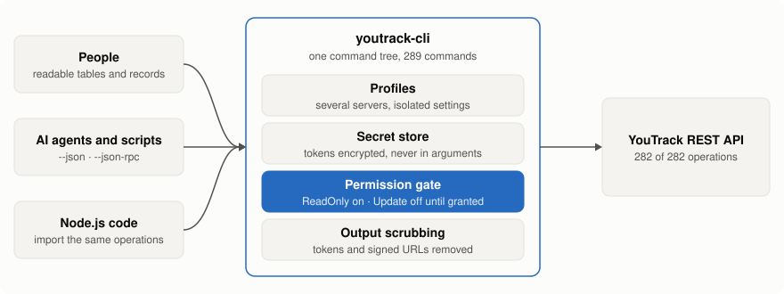
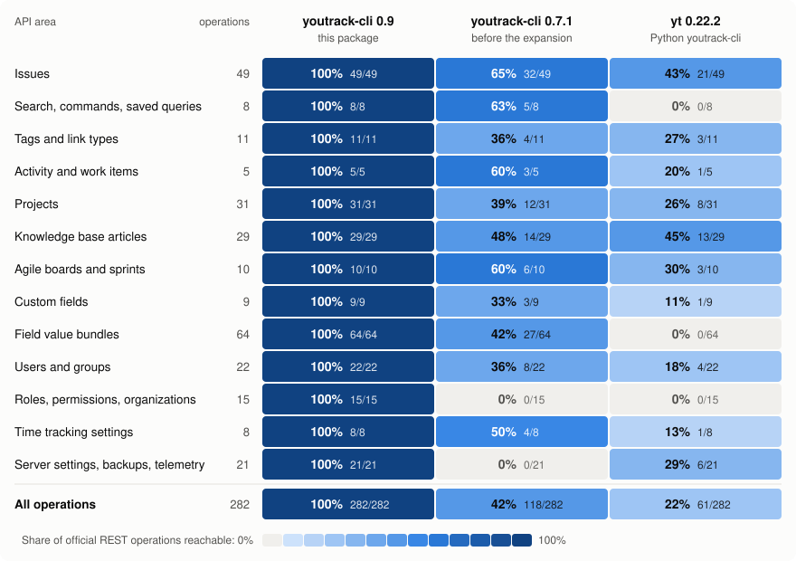

# youtrack-cli

**The whole YouTrack REST API as one command-line tool that is safe to hand to an AI agent.**

```sh
npm install --global @eyeauras/youtrack-cli
youtrack-cli profile configure        # server URL + permanent token, asked once
youtrack-cli issues list --query "project: DEMO #Unresolved"
```

## Why

| | |
|---|---|
| **Complete** | All 282 operations of the official YouTrack REST API are commands: issues, articles, boards, fields, users, roles, server settings, backups. No "drop to curl" gaps. |
| **Read-only by default** | A fresh profile can only read. Every write needs `permissions grant Update` for that profile, so an agent cannot change the tracker by accident. |
| **Cheap for agents** | `--json` everywhere, `--fields` to fetch only what the question needs, one bounded page per call, stable error codes, and a persistent `--json-rpc` session without restarting Node. |
| **No leaked secrets** | Tokens are kept encrypted in the platform secret store, never in profile files or command arguments, and are scrubbed from output and errors together with signed URLs. |
| **Predictable** | A command does what it says and nothing more: no guessed field types, hidden lookups, automatic retries or "first match wins". |
| **One tree, three ways in** | The same commands serve people (tables), scripts and agents (JSON, JSON-RPC) and Node.js code (import). |

<picture>
  <source media="(prefers-color-scheme: dark)" srcset="docs/images/how-it-works-dark.svg">
  
</picture>

## Coverage

Share of the 282 official REST operations each tool can call, by API area.

<picture>
  <source media="(prefers-color-scheme: dark)" srcset="docs/images/coverage-matrix-dark.svg">
  
</picture>

Numbers, method and caveats: [coverage comparison](docs/coverage-comparison.md).

## Use it

```sh
# read: pick the fields, get JSON
youtrack-cli issues get DEMO-12 --fields "idReadable,summary,description" --json

# write: allow it for this profile once, then create
youtrack-cli permissions grant Update --profile dev
youtrack-cli issues create --profile dev --body '{"project":{"shortName":"DEMO"},"summary":"Login page crashes on Safari"}'

# discover: every level has help
youtrack-cli --help
youtrack-cli issues --help
```

Needs Node.js 22+. Your server's edition and version and your account's rights still decide what
a call is allowed to do.

## More

- [Command reference](docs/reference.md): every command family, paging, writes, batches, downloads, sign-in.
- [Agent workflow](docs/agent-workflow.md): how an AI agent should read and write through this CLI.
- [Coverage comparison](docs/coverage-comparison.md) and the [per-operation map](docs/rest-api-coverage/current/README.md).
- [Release guide](docs/release.md). Built on AI CLI Factory (`@eyeauras/cli-factory`). MIT licensed.
